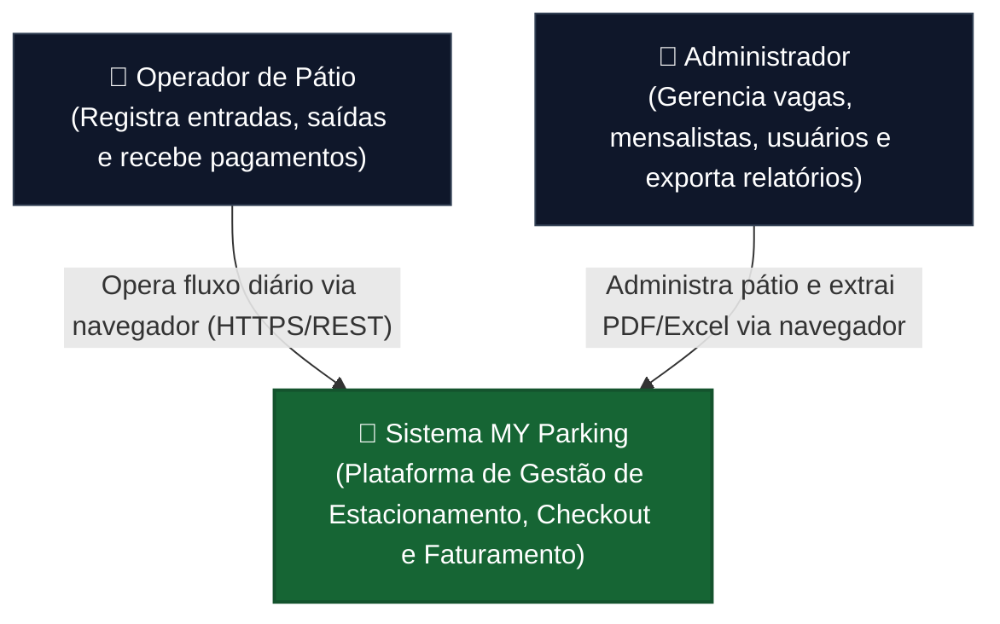
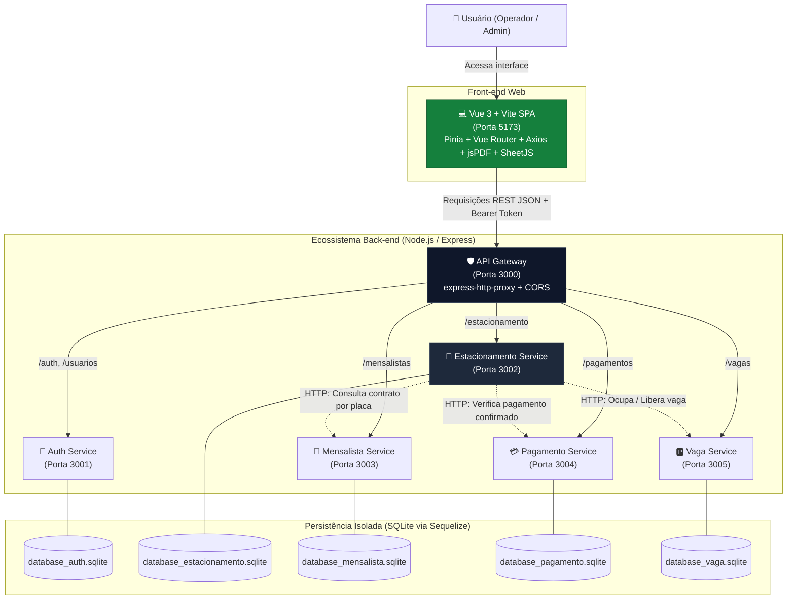
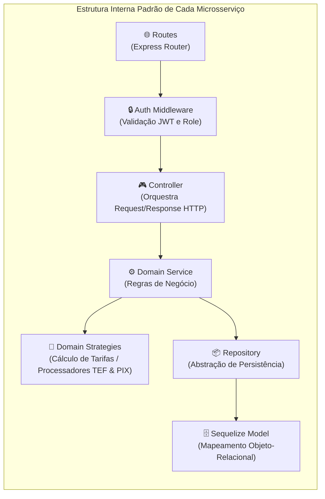
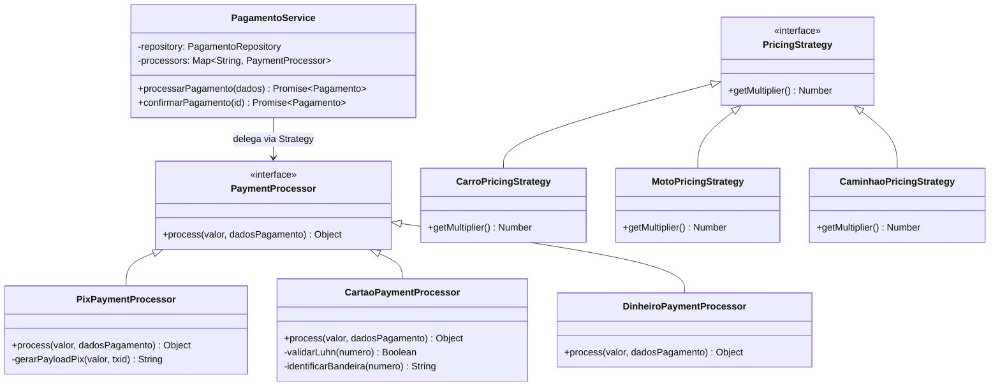
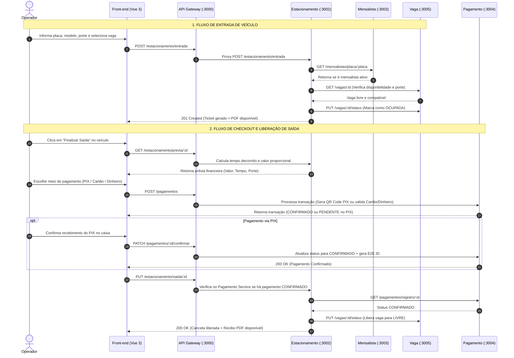

<div align="center">
  

  # MY Parking — Sistema de Gestão de Estacionamento

  **Plataforma corporativa completa para controle de pátio, faturamento, mensalistas e relatórios gerenciais em arquitetura de microsserviços.**

  
  
  
  
  
</div>

---

## Sumário

1. [Visão Geral do Projeto](#-1-visão-geral-do-projeto)
2. [Execução Rápida (1 Único Comando)](#-2-execução-rápida-1-único-comando)
3. [Credenciais de Acesso Padrão](#-3-credenciais-de-acesso-padrão)
4. [Funcionalidades Principais](#-4-funcionalidades-principais)
5. [Arquitetura de Microsserviços e Portas](#-5-arquitetura-de-microsserviços-e-portas)
6. [Diagramas de Arquitetura (Modelo C4)](#-6-diagramas-de-arquitetura-modelo-c4)
7. [Princípios S.O.L.I.D. e Padrões de Projeto](#-7-princípios-solid-e-padrões-de-projeto)
8. [Estrutura Completa de Pastas](#-8-estrutura-completa-de-pastas)
9. [Guia de Instalação do Zero (Passo a Passo)](#-9-guia-de-instalação-do-zero-passo-a-passo)
10. [Referência de Endpoints da API](#-10-referência-de-endpoints-da-api)
11. [Fluxo de Trabalho Git (Para Equipes)](#-11-fluxo-de-trabalho-git-para-equipes)
12. [Solução de Problemas (Troubleshooting)](#-12-solução-de-problemas-troubleshooting)

---

## 1. Visão Geral do Projeto

O **MY Parking** é um sistema completo de gerenciamento de estacionamento projetado para operação real de pátio. Ele integra recepção de veículos, alocação inteligente de vagas por porte, identificação automática de mensalistas, terminal de caixa com múltiplos meios de pagamento (PIX com QR Code dinâmico, Cartão de Crédito/Débito e Dinheiro com cálculo de troco), trava automática de cancela e emissão de relatórios gerenciais em **PDF** e **Excel (.xlsx)**.

O sistema foi construído sobre uma **Arquitetura de Microsserviços** no back-end (Node.js + Express + Sequelize + SQLite isolado por domínio) orquestrada por um **API Gateway** central e consumida por uma **Single Page Application (SPA)** responsiva em **Vue 3 + Vite**.

---

## 2. Execução Rápida (1 Único Comando)

Todos os **7 serviços** do ecossistema (5 microsserviços + API Gateway + Front-end Vue 3) são orquestrados em **uma única janela de terminal**, com logs coloridos por serviço, verificação automática de dependências (`node_modules`) e criação automática dos arquivos `.env`.

### Opção A — Duplo Clique (Windows)
Basta dar dois cliques no arquivo:
```text
iniciar.bat
```
*(Ou clique com o botão direito em `iniciar.ps1` → **Executar com o PowerShell**).*

### Opção B — Pelo Terminal (VS Code / PowerShell / CMD / Linux / macOS)
Abra o terminal na pasta `MY_SP-main` e execute:

```bash
npm start
```

> **O que o orquestrador (`start-all.js`) faz automaticamente?**
> 1. Verifica se as pastas `node_modules` e arquivos `.env` existem em cada um dos 7 serviços (caso falte algum, instala e configura sozinho).
> 2. Libera eventuais processos travados nas portas `3000` a `3005` e `5173`.
> 3. Inicia todos os serviços simultaneamente na mesma janela de terminal.
> 4. Ao pressionar `Ctrl + C`, encerra todos os 7 serviços de forma limpa.

### Comandos Disponíveis na Raiz

| Comando | Descrição |
| :--- | :--- |
| `npm start` | Inicia todos os 5 microsserviços, o API Gateway e o Front-end em 1 único terminal |
| `npm run setup` | Força a reinstalação de dependências (`npm install`) e recriação dos `.env` em todos os serviços |
| `npm run start:backend` | Inicia apenas o API Gateway e os 5 microsserviços (sem o Front-end) |

### Endereços de Acesso Local

- **Aplicação Web (Front-end):** [http://localhost:5173](http://localhost:5173)
- **API Gateway (Ponto Único de Entrada):** [http://localhost:3000](http://localhost:3000)
- **Status Geral dos Serviços (Health Check):** [http://localhost:3000/status](http://localhost:3000/status)

---

## 3. Credenciais de Acesso Padrão

Na primeira inicialização, o serviço de autenticação (`auth-service`) cria automaticamente uma conta de administrador padrão:

| Campo | Valor |
| :--- | :--- |
| **Usuário (Login)** | `admin` |
| **Senha** | `admin123` |
| **Perfil** | `ADMIN` (Acesso total ao sistema, relatórios e gestão de operadores) |

> **Dica:** Na tela de login existe um botão de preenchimento rápido das credenciais de demonstração para agilizar testes.

---

## 4. Funcionalidades Principais

### 4.1. Painel Operacional (Dashboard)
- Indicadores em tempo real de **Total de Vagas**, **Vagas Livres**, **Vagas Ocupadas** e **Taxa de Ocupação (%)** com barra de progresso visual.
- Lista de veículos atualmente no pátio com tempo decorrido e atalho direto para encerramento de estadia.
- Busca rápida por placa ou modelo diretamente na tabela operacional.

### 4.2. Entrada de Veículos e Ticket em PDF
- Validação de placas no padrão brasileiro antigo (`ABC-1234`) e Mercosul (`ABC1D23`).
- **Identificação Automática de Mensalistas:** Ao digitar a placa, o sistema consulta o serviço de mensalistas e sinaliza se o veículo possui contrato ativo (isento de cobrança avulsa).
- **Compatibilidade Inteligente de Vagas:** Filtra e sugere apenas vagas livres compatíveis com o porte do veículo:
  - **Moto:** Pode estacionar em vagas de Moto, Carro ou Caminhão.
  - **Carro:** Pode estacionar em vagas de Carro ou Caminhão.
  - **Caminhão:** Exclusivo para vagas de Caminhão.
- **Emissão de Comprovante de Entrada (PDF):** Gera ticket formatado em PDF com número de controle, placa, vaga alocada, data/hora de entrada e identificação visual MY Parking.

### 4.3. Saída de Veículos, Checkout Real e Controle de Cancela
- **Cálculo Automático de Tarifa:** Tarifa base para a 1ª hora (`R$ 10,00`) + adicional por hora ou fração excedente (`R$ 5,00/h`), aplicando multiplicador conforme o porte do veículo (`1.0x` Carro, `0.5x` Moto, `2.0x` Caminhão).
- **Terminal de Pagamento Integrado:**
  - **PIX (QR Code Dinâmico + Copia e Cola):** Gera payload EMVCo BR Code válido e renderiza o QR Code SVG na tela com status `PENDENTE`. A cancela só é liberada após a confirmação de recebimento (`CONFIRMADO`), gerando identificador fim-a-fim (`E2E ID`).
  - **Cartão de Crédito / Débito (TEF):** Validação algorítmica de numeração de cartão, identificação automática da bandeira (Visa, Mastercard, Elo, Amex, Hipercard), seleção de modalidade (Crédito à vista, parcelado ou Débito) e emissão de código **NSU** e **Código de Autorização**.
  - **Dinheiro em Espécie:** Cálculo automático de troco em tempo real e validação de valor recebido suficiente.
- **Trava de Segurança na Cancela:** O back-end bloqueia a baixa de saída (HTTP `402 Payment Required`) caso um veículo avulso tente sair sem um pagamento confirmado vinculado ao registro.
- **Recibo Fiscal de Saída (PDF):** Exportação imediata do comprovante de saída com detalhamento de permanência, forma de pagamento, NSU/E2E ID e valor pago.

### 4.4. Mapa e Gestão de Vagas
- Visualização em grade interativa com diferenciação por cores (Livre vs. Ocupada) e filtro por tipo de vaga.
- Criação rápida de vagas individuais ou **geração em lote** (ex.: criar 10 vagas de Carro de uma só vez com numeração sequencial automática `A-01`, `A-02`...).
- Alteração manual de status e exclusão administrativa (restrita a administradores).

### 4.5. Gestão de Clientes Mensalistas
- Cadastro completo de clientes mensalistas (Nome, CPF, Telefone, Placa, Tipo de Veículo, Valor da Mensalidade e Dia de Vencimento).
- Ativação e suspensão rápida de contratos.

### 4.6. Relatórios Financeiros e Exportação Profissional (PDF e Excel)
- Filtro por intervalo de datas personalizado ou atalhos rápidos (**Hoje**, **Últimos 7 dias**, **Este Mês**, **Todo o Período**).
- Filtro por modalidade (Todos, Avulsos ou Mensalistas) e busca textual por placa/modelo.
- **Resumo Executivo:** Faturamento total no período, total de atendimentos, ticket médio por veículo avulso e proporção entre avulsos e mensalistas.
- **Exportação em PDF Corporativo (`jsPDF` + `jspdf-autotable`):** Documento em orientação paisagem com cabeçalho institucional MY Parking, cards de indicadores financeiros, tabela zebrada de movimentações e rodapé paginado.
- **Exportação em Excel Profissional (`.xlsx` via `SheetJS`):** Planilha com **2 abas** formatadas e colunas autoajustadas:
  1. `Movimentacoes`: Registro completo de entradas, saídas, tempo de permanência, modalidade e valores.
  2. `Resumo Executivo`: Indicadores consolidados do período filtrado.

### 4.7. Controle de Acesso Baseado em Papéis (RBAC)
- Perfis **Administrador (`ADMIN`)** e **Operador (`OPERADOR`)**.
- Autenticação via token **JWT (JSON Web Token)** validado centralmente pelo API Gateway e repassado aos microsserviços.

---

## 5. Arquitetura de Microsserviços e Portas

O sistema adota o padrão **Database per Service** (cada microsserviço gerencia seu próprio banco de dados SQLite de forma isolada, sem acoplamento direto de tabelas entre serviços diferentes).

| Serviço | Porta | Banco de Dados Local | Responsabilidade Principal |
| :--- | :---: | :--- | :--- |
| **Front-end (Vue 3 + Vite)** | `5173` | — | Interface gráfica responsiva (SPA), geração de relatórios PDF/Excel e experiência do operador |
| **API Gateway** | `3000` | — | Ponto único de entrada (`Reverse Proxy`), roteamento dinâmico e repasse de headers de autenticação |
| **Auth Service** | `3001` | `database_auth.sqlite` | Autenticação JWT, criptografia de senhas (`bcryptjs`) e gestão de usuários/operadores |
| **Estacionamento Service** | `3002` | `database_estacionamento.sqlite` | Orquestração de entrada e saída de veículos, cálculo de tarifas e histórico de pátio |
| **Mensalista Service** | `3003` | `database_mensalista.sqlite` | Cadastro de contratos mensais e verificação de adimplência/isenção por placa |
| **Pagamento Service** | `3004` | `database_pagamento.sqlite` | Processamento de pagamentos (PIX EMVCo, Cartão TEF, Dinheiro), NSU/E2E e confirmação de transações |
| **Vaga Service** | `3005` | `database_vaga.sqlite` | Controle de disponibilidade do pátio, criação em lote e validação de compatibilidade física |

---

## 6. Diagramas de Arquitetura (Modelo C4)

A arquitetura do **MY Parking** está documentada abaixo seguindo os 4 níveis do **Modelo C4** (Contexto, Containers, Componentes e Código), além do diagrama de sequência operacional.

### 6.1. Nível 1 — Diagrama de Contexto (C4)
Visão macro de como operadores e administradores interagem com o sistema MY Parking.



---

### 6.2. Nível 2 — Diagrama de Containers (C4)
Detalhamento dos containers de software (Front-end, API Gateway, 5 Microsserviços e Bancos de Dados).



---

### 6.3. Nível 3 — Diagrama de Componentes Internos (C4)
Cada microsserviço segue uma arquitetura em camadas bem definida (**Routes → Middlewares → Controllers → Services & Strategies → Repositories → Models/Database**), garantindo separação de responsabilidades.



---

### 6.4. Nível 4 — Diagrama de Classes e Estratégias de Domínio (C4)
Representação das principais abstrações orientadas a objetos nos serviços de **Pagamento** e **Estacionamento**.



---

### 6.5. Diagrama de Sequência — Fluxo Completo de Entrada, Checkout e Saída



---

## 7. Princípios S.O.L.I.D. e Padrões de Projeto

O código do back-end foi estruturado aplicando princípios de engenharia de software limpa:

1. **S — Single Responsibility Principle (Responsabilidade Única):**
   - `Controllers` lidam exclusivamente com a camada HTTP (status codes, leitura de `req.body` e envio de JSON).
   - `Services` concentram a lógica e regras de negócio do domínio.
   - `Repositories` encapsulam consultas ao banco de dados Sequelize/SQLite.
2. **O — Open/Closed Principle (Aberto para Extensão, Fechado para Modificação):**
   - Implementado através do **Strategy Pattern** tanto na precificação por porte de veículo (`PricingStrategies.js` no `estacionamento-service`) quanto no processamento de meios de pagamento (`PaymentProcessors.js` no `pagamento-service`) e compatibilidade de vagas (`SpotCompatibilityStrategy.js` no `vaga-service`). Adicionar uma nova forma de pagamento ou novo porte de veículo não exige alterar o código central do serviço.
3. **L — Liskov Substitution Principle (Substituição de Liskov):**
   - Todas as subclasses de `PaymentProcessor` (`PixPaymentProcessor`, `CartaoPaymentProcessor`, `DinheiroPaymentProcessor`) respeitam o mesmo contrato `.process(valor, dados)` e podem ser substituídas de forma transparente pelo `PagamentoService`.
4. **I — Interface Segregation Principle (Segregação de Interfaces):**
   - Middlewares modulares (`verificarToken` separado de `apenasAdmin`), garantindo que rotas operacionais não dependam de validações administrativas desnecessárias.
5. **D — Dependency Inversion Principle (Inversão de Dependência):**
   - Os `Controllers` recebem instâncias de `Services` e os `Services` recebem `Repositories` e clientes HTTP (`ServiceClients.js`) via **Injeção de Dependência no construtor**, facilitando testes unitários e manutenção.

---

## 8. Estrutura Completa de Pastas

```text
MY_SP-main/
├── assets/                          # Logotipos oficiais do projeto (logo.jpg, logo.png)
├── iniciar.bat                      # Inicializador com duplo clique para Windows (CMD)
├── iniciar.ps1                      # Inicializador para Windows PowerShell
├── start-all.js                     # Orquestrador Node.js que roda os 7 serviços em 1 terminal
├── package.json                     # Scripts globais (npm start, npm run setup, npm run start:backend)
├── README.md                        # Documentação única e detalhada do projeto
│
├── gateway/                         # API Gateway (Porta 3000)
│   ├── index.js                     # Roteamento proxy reverso e endpoint /status
│   └── package.json
│
├── frontend/                        # Aplicação Web Vue 3 + Vite (Porta 5173)
│   ├── index.html                   # HTML raiz com fonte Inter e favicon MY Parking
│   ├── package.json                 # Dependências (vue, pinia, vue-router, axios, jspdf, xlsx)
│   └── src/
│       ├── assets/                  # Logos otimizadas para a interface e relatórios PDF
│       ├── components/
│       │   └── AppLayout.vue        # Menu lateral responsivo, topbar e controle de sessão
│       ├── router/
│       │   └── index.js             # Rotas protegidas por guardas de autenticação
│       ├── services/
│       │   └── api.js               # Cliente Axios configurado com interceptors JWT
│       ├── stores/
│       │   └── auth.js              # Gerenciamento de estado global de autenticação (Pinia)
│       ├── utils/
│       │   └── exportadores.js      # Motor de exportação profissional em PDF e Excel (.xlsx)
│       └── views/
│           ├── LoginView.vue        # Tela de autenticação corporativa
│           ├── DashboardView.vue    # Painel operacional em tempo real
│           ├── EntradaView.vue      # Registro de entrada e emissão de ticket PDF
│           ├── SaidaView.vue        # Checkout (PIX QR Code, Cartão, Dinheiro) e recibo PDF
│           ├── VagasView.vue        # Mapa interativo e geração de vagas em lote
│           ├── MensalistasView.vue  # Gestão de contratos mensais
│           ├── RelatoriosView.vue   # Auditoria financeira e exportação PDF / Excel
│           └── UsuariosView.vue     # Administração de operadores e permissões
│
└── services/                        # Microsserviços de Domínio
    ├── auth-service/                # Porta 3001 — Autenticação e Operadores
    ├── estacionamento-service/      # Porta 3002 — Fluxo de Pátio e Tarifação
    ├── mensalista-service/          # Porta 3003 — Contratos de Mensalistas
    ├── pagamento-service/           # Porta 3004 — Processamento PIX, Cartão e Espécie
    └── vaga-service/                # Porta 3005 — Gestão de Vagas e Compatibilidade
```

---

## 9. Guia de Instalação do Zero (Passo a Passo)

Caso esteja configurando uma máquina nova pela primeira vez, siga este roteiro:

### 9.1. Pré-requisitos
1. **[Node.js](https://nodejs.org/)** (versão **18 LTS** ou superior — inclui o `npm`).
2. **[Git](https://git-scm.com/)** instalado.
3. **[Visual Studio Code](https://code.visualstudio.com/)** (recomendado).

#### Extensões Recomendadas para o VS Code
- **Vue - Official (Volar):** Suporte completo a arquivos `.vue`.
- **ESLint & Prettier:** Padronização e formatação automática de código.
- **SQLite Viewer:** Para visualizar os arquivos `.sqlite` diretamente no editor.
- **Thunder Client** ou **REST Client:** Para testar chamadas de API manualmente.

### 9.2. Clonando e Executando
```bash
# 1. Clone o repositório
git clone <URL_DO_REPOSITORIO>

# 2. Entre na pasta do projeto
cd MY_SP-main

# 3. Instale todas as dependências e gere os arquivos .env automaticamente
npm run setup

# 4. Inicie todos os serviços em um único terminal
npm start
```

### 9.3. Variáveis de Ambiente (`.env`)
O script `start-all.js` cria automaticamente os arquivos `.env` de todos os serviços caso não existam. Abaixo está a referência das variáveis utilizadas:

| Serviço | Variáveis Configuradas Automaticamente |
| :--- | :--- |
| `gateway/.env` | `PORT=3000`, URLs dos 5 microsserviços (`http://localhost:3001` a `3005`) |
| `services/auth-service/.env` | `PORT=3001`, `JWT_SECRET=chave_secreta_super_segura_123` |
| `services/estacionamento-service/.env` | `PORT=3002`, `JWT_SECRET`, URLs de Vaga, Mensalista e Pagamento |
| `services/mensalista-service/.env` | `PORT=3003`, `JWT_SECRET=chave_secreta_super_segura_123` |
| `services/pagamento-service/.env` | `PORT=3004`, `JWT_SECRET=chave_secreta_super_segura_123` |
| `services/vaga-service/.env` | `PORT=3005`, `JWT_SECRET=chave_secreta_super_segura_123` |

---

## 10. Referência de Endpoints da API

Todas as chamadas podem ser feitas diretamente ao **API Gateway (`http://localhost:3000`)**. Rotas protegidas exigem o cabeçalho `Authorization: Bearer <TOKEN_JWT>`.

### Autenticação e Operadores (`auth-service`)
| Método | Rota no Gateway | Permissão | Descrição |
| :---: | :--- | :---: | :--- |
| `POST` | `/auth/login` | Pública | Autentica usuário e retorna token JWT + dados do perfil |
| `POST` | `/auth/registrar` | Pública / Admin | Registra um novo operador no sistema |
| `GET` | `/usuarios` | `ADMIN` | Lista todos os operadores cadastrados |
| `DELETE` | `/usuarios/:id` | `ADMIN` | Remove um operador do sistema |

### Controle de Pátio (`estacionamento-service`)
| Método | Rota no Gateway | Permissão | Descrição |
| :---: | :--- | :---: | :--- |
| `POST` | `/estacionamento/entrada` | Autenticado | Registra entrada de veículo, valida porte e ocupa a vaga |
| `GET` | `/estacionamento/ativos` | Autenticado | Lista todos os veículos atualmente estacionados no pátio |
| `GET` | `/estacionamento/previa/:id` | Autenticado | Calcula prévia de tempo e valor a pagar antes de finalizar a saída |
| `PUT` | `/estacionamento/saida/:id` | Autenticado | Registra saída (exige pagamento confirmado para avulsos) e libera a vaga |
| `GET` | `/estacionamento/relatorio` | `ADMIN` | Retorna histórico completo de movimentações (`?inicio=YYYY-MM-DD&fim=YYYY-MM-DD`) |

### Pagamentos e Caixa (`pagamento-service`)
| Método | Rota no Gateway | Permissão | Descrição |
| :---: | :--- | :---: | :--- |
| `POST` | `/pagamentos` | Autenticado | Cria transação (`PIX`, `CARTAO` ou `DINHEIRO`) |
| `PATCH` | `/pagamentos/:id/confirmar` | Autenticado | Confirma liquidação de pagamento PIX pendente e gera código E2E |
| `PATCH` | `/pagamentos/:id/cancelar` | Autenticado | Cancela um pagamento pendente |
| `GET` | `/pagamentos/registro/:id` | Autenticado | Consulta o último pagamento vinculado a um registro de estacionamento |
| `GET` | `/pagamentos` | Autenticado | Lista todas as transações financeiras processadas |

### Gestão de Vagas (`vaga-service`)
| Método | Rota no Gateway | Permissão | Descrição |
| :---: | :--- | :---: | :--- |
| `GET` | `/vagas` | Autenticado | Lista todas as vagas do pátio (`?status=LIVRE` opcional) |
| `POST` | `/vagas` | `ADMIN` | Cria uma nova vaga (`numero`, `tipo`: `CARRO`, `MOTO`, `CAMINHAO`) |
| `GET` | `/vagas/:id` | Autenticado | Busca detalhes de uma vaga específica |
| `PUT` | `/vagas/:id/status` | Autenticado | Atualiza status da vaga (`LIVRE` ou `OCUPADA`) |
| `DELETE` | `/vagas/:id` | `ADMIN` | Exclui uma vaga do pátio |

### Clientes Mensalistas (`mensalista-service`)
| Método | Rota no Gateway | Permissão | Descrição |
| :---: | :--- | :---: | :--- |
| `GET` | `/mensalistas` | Autenticado | Lista todos os contratos de mensalistas |
| `POST` | `/mensalistas` | Autenticado | Cadastra novo mensalista |
| `GET` | `/mensalistas/placa/:placa` | Autenticado | Verifica se uma placa pertence a um mensalista com contrato ativo |
| `PUT` | `/mensalistas/:id/status` | Autenticado | Ativa ou inativa o contrato de um mensalista |

---

## 11. Fluxo de Trabalho Git (Para Equipes)

Para manter o repositório organizado durante o desenvolvimento em equipe:

```bash
# 1. Atualize sua branch principal antes de começar
git checkout main
git pull origin main

# 2. Crie uma branch específica para sua tarefa
git checkout -b feature/minha-melhoria

# 3. Verifique os arquivos alterados e faça commits semânticos
git status
git add .
git commit -m "feat: descrição clara da melhoria implementada"

# 4. Envie sua branch para o repositório remoto e abra um Pull Request
git push origin feature/minha-melhoria
```

---

## 12. Solução de Problemas (Troubleshooting)

### 1. Erro `EADDRINUSE: address already in use`
Significa que alguma porta (`3000` a `3005` ou `5173`) já está em uso por outra instância aberta.
- **Solução:** Basta rodar `npm start` novamente. O script `start-all.js` possui uma rotina integrada (`freePorts`) que identifica e encerra processos antigos automaticamente antes de subir os serviços.

### 2. Erro `Cannot find module '...'`
Alguma dependência não foi instalada em um dos serviços.
- **Solução:** Execute `npm run setup` na pasta raiz `MY_SP-main` para reinstalar os pacotes de todos os 7 projetos de uma só vez.

### 3. Erro `401 Unauthorized` ou `403 Forbidden`
O token JWT expirou ou o usuário logado possui perfil `OPERADOR` tentando acessar um recurso exclusivo de `ADMIN` (como exclusão de vagas ou gestão de operadores).
- **Solução:** Faça logout no menu lateral inferior e entre com a conta `admin` / `admin123`.

### 4. Resetar os Bancos de Dados para o Estado Inicial
Como cada microsserviço utiliza SQLite local, caso queira limpar todos os registros de teste:
1. Pare o servidor (`Ctrl + C`).
2. Apague os arquivos `database_*.sqlite` dentro de `services/*/`.
3. Inicie novamente com `npm start` (as tabelas e o usuário `admin` serão recriados automaticamente).
